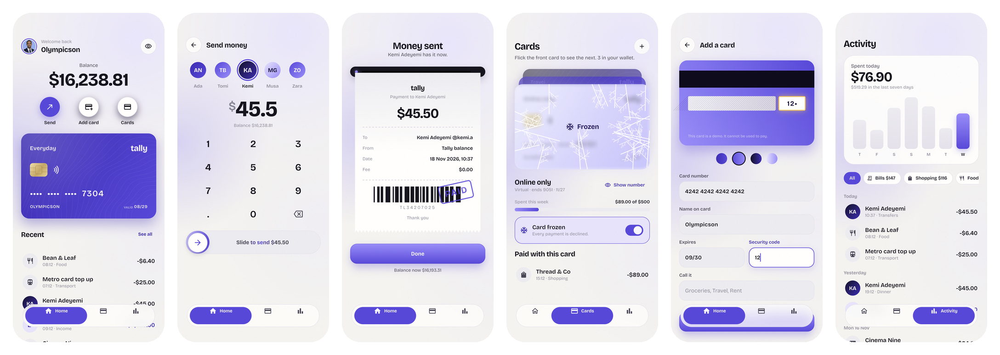
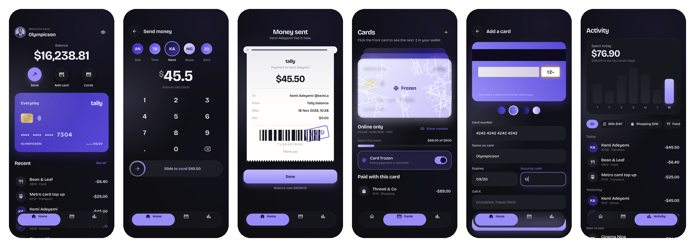

<p align="center">
  
</p>

<h1 align="center">Tally</h1>

<p align="center">
  A Flutter money app made of micro-animations. Slide to pay and a receipt
  prints out of a slot and gets stamped PAID; cards fill in as you type,
  turn over for the security code, and frost over when you freeze them.
</p>

<p align="center">
  <a href="https://flutterzip.com"></a>
  <a href="https://instagram.com/flutter_zip"></a>
  
  
  
  
  
</p>

<p align="center">
  
</p>
<p align="center">
  
</p>

## Highlights

- **A receipt that prints.** After paying, the paper feeds out of a printer
  slot in short steps like a thermal printer, with a tick of haptics on
  each and the slot's light blinking, torn edge first. Then a PAID stamp
  drops from above and slams onto it.
- **Slide to pay.** The label shimmers, the track fills behind the knob, and
  at the end it locks, spins and turns into a tick. Let go early and it
  springs back.
- **A keypad with feel.** Each digit rises and pops into place, keys flash a
  ring, and a refused key (a third decimal, more than your balance) shakes
  the amount.
- **Cards drawn in code**, with guilloche lines, a chip and contactless mark,
  and a sheen of light that sweeps across now and then. **Add a card** and
  it fills in as you type: each dot drops out as a digit drops in, the
  colour slides as you pick one, and it turns over in 3D for the security
  code.
- **Freeze a card** and frost grows in from every edge, ice crystals
  branching as they go, the card blurs behind it and "Frozen" settles in
  the middle. Unfreeze and it melts.
- **A wallet you flick through**, a balance whose digits roll on their own
  wheels, spending bars that spring up, and light and dark from one palette
  file.

## Try the demo

- Tap **Send**, pick someone, type an amount and slide to send. Watch the
  receipt.
- On **Cards**, flick the front card sideways, flip **Freeze card**, and tap
  **Show number**.
- Tap **+** to add a card: try `4242 4242 4242 4242`, any future month and
  any three digits. A wrong digit in the number is caught.
- On **Activity**, tap the days and the categories.
- The round button on the right edge opens **Demo settings**: theme and
  reset demo data.

## Getting started

```bash
git clone https://github.com/flutterzip/tally.git
cd tally
flutter pub get
flutter run
```

Open a screen straight away: `--dart-define=startRoute=send` (also
`receipt`, `cards`, `add_card`, `activity`). `--dart-define=timingScale=0`
skips every wait.

## Make it yours

| To change | Edit |
|---|---|
| Every colour, light and dark | `lib/config/palette.dart` |
| The four card colours | `CardTones` in `lib/widgets/cards.dart` |
| You, your cards, contacts and activity (days ago) | `assets/data/wallet.json` |
| How money is shown | `money()` in `lib/data/models.dart` |
| What the keypad allows | `pressKey()` in `lib/data/models.dart` |
| What the receipt says | `lib/screens/receipt/receipt_screen.dart` |
| How things move | `lib/config/motion.dart` |
| The app's name and tagline | `lib/config/brand.dart` |

## Project structure

```
lib/
  config/     palette, theme, motion, timing, brand
  data/       money in cents, cards, contacts, activity, dates
  state/      the seed, cards, payments and balance (Riverpod, saved)
  widgets/    cards and frost, the receipt, keypad and slide to pay,
              rows and bars; widgets.dart is one import for all
  screens/    home, send, receipt, cards, add card, activity, shell, splash
  demo/       Demo settings button and launch hooks
```

## How it is built

Money is kept in whole cents throughout and only turned into text by
`money()`. The balance is never stored: it is the opening balance plus
every movement, so it always agrees with the activity list. Seeded activity
is dated in days before today so the demo never goes stale; payments you
make are saved.

The receipt is one widget: the paper is laid out at full size and revealed
from under the slot by a clip whose height steps forward fourteen times,
each step easing out, which is what makes it read as a printer rather than
a slide. Frost is a painter: crystals start at random points along the
edges and branch three levels deep, each grown to its share of the
progress, so running the progress backwards melts it.

## Testing

```bash
flutter analyze --fatal-infos
flutter test
```

19 tests cover money formatting, the keypad's rules, card number grouping,
the Luhn check and expiry, freezing and adding cards (and that both are
saved), the balance, sending (and refusing more than you have), the week and
categories, every screen, sliding to send, flicking the wallet, the add card
form catching a bad number and turning over for the code, and that no
on-screen string has an em dash. `tool/shots.sh` takes the README
screenshots on the iOS simulator.

## Made by FlutterZip

A new Flutter UI every day. Follow [@flutter_zip](https://instagram.com/flutter_zip)
and find more at [flutterzip.com](https://flutterzip.com).

## Credits

- [Bricolage Grotesque](https://github.com/ateliertriay/bricolage) by
  Mathieu Triay, SIL Open Font License 1.1 (`assets/fonts/OFL.txt`).
- The cards, frost, receipt and icon are drawn in code for this project.
  People, shops and card numbers are invented. Tally is a demo: it moves no
  real money.

## License

MIT. See [LICENSE](LICENSE).
